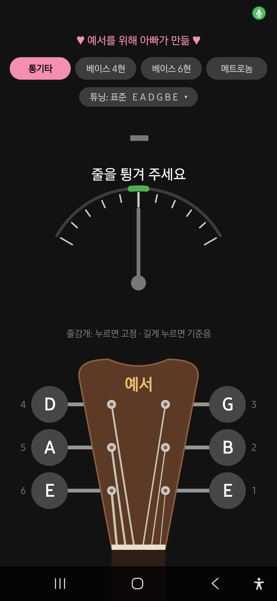
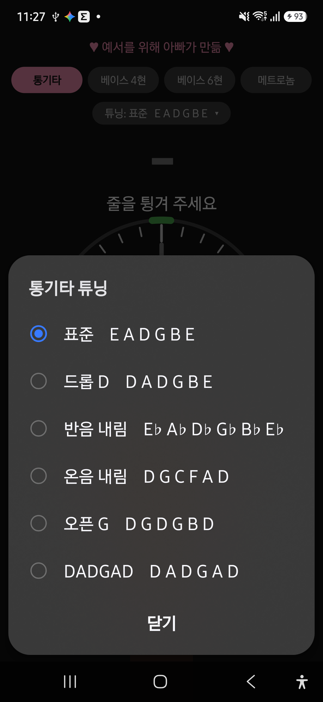
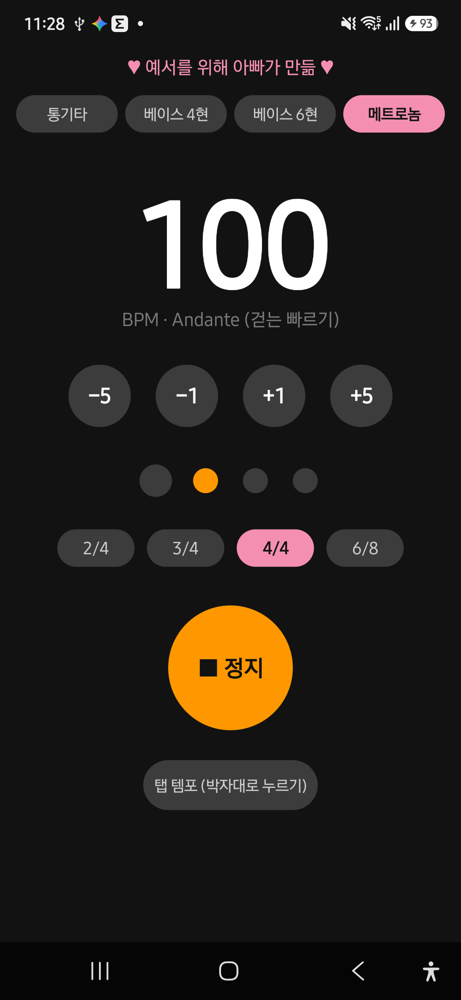

# 🎸 예서 튜너 (Yeseo Tuner)

> ♥ 예서를 위해 아빠가 만듦 ♥

통기타를 배우고 베이스를 치고 싶어 하는 딸 예서를 위해 만든 **광고 없는 안드로이드 튜너**입니다.
기본에 충실하게, 튜닝·기준음·메트로놈만 담았습니다.

<p align="center">
  
  
  
</p>

## 설치

1. [Releases](https://github.com/fill-light/YeseoTuner/releases)에서 최신 `YeseoTuner-*.apk`를 내려받습니다.
2. 폰/태블릿에서 APK를 열어 설치합니다.
   - "출처를 알 수 없는 앱" 경고가 나오면, 파일을 연 앱(내 파일·Chrome·드라이브 등)에 **이 출처 허용**을 켭니다.
   - Play 프로텍트 경고는 스토어를 거치지 않은 앱이라 나오는 것이므로 **무시하고 설치**를 누르면 됩니다.
3. 처음 실행 시 **마이크 권한**을 허용합니다.

Android 7.0 (API 24) 이상, 폰·태블릿·가로 화면 모두 지원합니다.

## 기능

### 튜너
- **악기**: 통기타 · 베이스 4현 · 베이스 6현
- **튜닝**
  | 악기 | 튜닝 |
  |---|---|
  | 통기타 | 표준(EADGBE), 드롭 D, 반음 내림, 온음 내림, 오픈 G, DADGAD |
  | 베이스 4현 | 표준(EADG), 드롭 D, 반음 내림 |
  | 베이스 6현 | 표준(BEADGC), 반음 내림 |
- 줄을 튕기면 **가장 가까운 줄을 자동 인식**하고, 바늘 미터(±50 cent)와 안내 문구로 알려줍니다.
  ±4 cent 안에 들어오면 초록색 **"정확해요"**.
- 화면 아래 **기타 헤드 그림의 줄감개가 곧 줄 버튼**입니다.
  - **누르기**: 그 줄로 고정 (줄이 많이 풀려 있어 자동 인식이 헷갈릴 때) · 다시 누르면 자동
  - **길게 누르기**: 그 줄의 **기준음**을 2.5초간 재생
- 마지막으로 고른 악기와 악기별 튜닝을 기억합니다.

### 메트로놈
- 30 ~ 250 BPM, −5 / −1 / +1 / +5 버튼, 빠르기말 표시 (Andante 등)
- 박자 2/4 · 3/4 · 4/4 · 6/8, 첫 박 강조(높은 소리 + 분홍 점)
- **탭 템포**: 버튼을 박자대로 두드리면 BPM 자동 설정

## 기술 요약

| 항목 | 내용 |
|---|---|
| 언어 / UI | Kotlin, 외부 라이브러리 없이 커스텀 `View` + `Canvas`로 직접 그림 (APK 약 0.8 MB) |
| 음높이 검출 | **YIN** 알고리즘 (de Cheveigné & Kawahara, 2002) + 포물선 보간 |
| 입력 | `AudioRecord` 44.1 kHz, `VOICE_RECOGNITION` 소스 (자동 게인/노이즈 억제 회피), 1024 샘플(약 23 ms)마다 분석 |
| 베이스 대응 | 최저 B♭0(29 Hz)까지 잡기 위해 8192 샘플 창을 2배 데시메이션(22.05 kHz) → 기타와 같은 연산량으로 긴 주기 분석 |
| 안정화 | ① 최근 5개 중앙값 ② 센트 단위 지수 평활(큰 변화 40 cent 이상은 즉시 추종) ③ 바늘 이징 ④ 초록 판정 히스테리시스(±4 진입 / ±6 이탈) |
| 기준음 | 배음 6개를 합성한 줄 튕김 소리 (폰 스피커가 못 내는 베이스 기음도 배음으로 음높이 인지). 재생 중엔 마이크 입력 무시 |
| 메트로놈 | `AudioTrack` 스트림에 클릭을 샘플 단위로 섞어 넣어 **템포 오차 누적 없음** |
| 화면 | Android 15 edge-to-edge 대응(상태바·내비바·카메라 컷아웃 회피), 화면 높이 비율 기반 레이아웃으로 폰/태블릿/가로 모두 대응 |

## 프로젝트 구조

```
app/src/main/java/com/guitartune/
├── MainActivity.kt   마이크 입력 루프, 평활화, 화면/오디오 연결, 설정 저장
├── PitchDetector.kt  YIN 음높이 검출
├── Instrument.kt     악기와 튜닝 정의 (MIDI 음번호 → 주파수/음이름)
├── TunerView.kt      전체 UI (헤더, 튜너, 헤드·줄감개, 메트로놈, 터치 처리)
├── TonePlayer.kt     기준음 합성·재생
└── Metronome.kt      샘플 정확도 메트로놈 엔진
```

## 빌드

Android Studio로 폴더를 열고 ▶ Run, 또는 명령줄에서:

```bash
./gradlew assembleDebug
```

결과물: `app/build/outputs/apk/debug/app-debug.apk`
(Gradle 8.11.1 / AGP 8.7.3 / Kotlin 2.1.0 / JDK 17~21)

## 개발 과정

| 버전 | 내용 |
|---|---|
| 1.0 | 통기타 표준 튜닝 튜너: YIN 검출, 바늘 미터, 줄 자동 인식 · 줄 수동 고정, 태블릿/가로 대응, 기타 헤드 그림 UI, 모던 기타 아이콘, "예서" 헤드 로고와 헌정 문구, 베이스 4현·6현 추가 |
| 1.1 | 앱 이름 "예서 튜너", Android 15 상태바 겹침 수정 |
| 1.2 | 바늘 떨림 개선(평활화·히스테리시스), 대체 튜닝, 줄감개 길게 눌러 기준음, 메트로놈(박자·탭 템포) |
